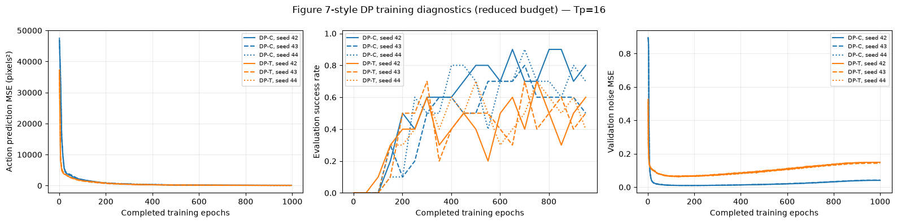
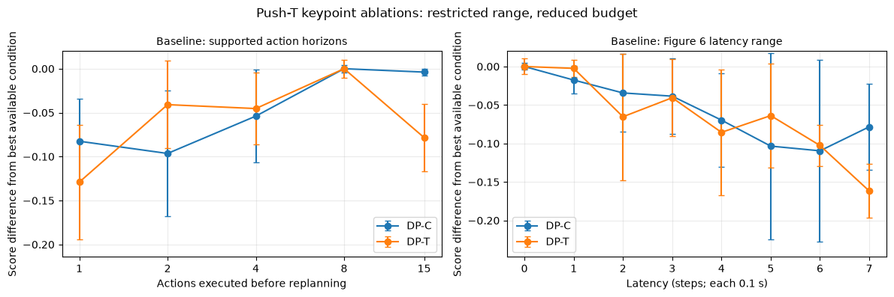

# Push-T Diffusion Policy

**Asya Ünal**

A single-notebook implementation of convolutional (DP-C) and Transformer (DP-T) diffusion policies for simulated Push-T. It covers dataset inspection, DDPM training, policy rollouts, checkpoint comparisons, training diagnostics, and restricted action-horizon and observation-delay ablations.

This is a **reduced-budget reproduction** using keypoint observations. It does not reproduce every setting or result of the original paper.

[Open the notebook](task1_pusht_submission.ipynb) · [Open in Google Colab](https://colab.research.google.com/github/asyau/pusht-diffusion-policy/blob/main/task1_pusht_submission.ipynb) · [Browse image outputs](images/)

## Contents

- [`task1_pusht_submission.ipynb`](task1_pusht_submission.ipynb): implementation and saved outputs, including ten HTML rollout animations.
- [`images/data/`](images/data/): demonstration frames, coordinate and episode distributions, keypoints, and trajectories.
- [`images/results/`](images/results/): training diagnostics and ablation plots.
- [`images/rollouts/`](images/rollouts/): five-frame rollout summaries for five environment seeds per architecture.
- [`THIRD_PARTY_NOTICES.md`](THIRD_PARTY_NOTICES.md): attribution and license for adapted simulation code.

The 18 PNG images are exported directly from the notebook's saved outputs. Dataset archives, model checkpoints, and separate training-history files are not included.

## Method and experiment settings

The policy observes nine 2D block keypoints and the pusher's 2D position (20 values), and predicts absolute 2D pusher targets. DP-C jointly denoises actions and observations, keeping the two known observation steps fixed by inpainting. DP-T denoises actions conditioned on observations through cross-attention. Both use DDPM with 100 reverse steps.

| Setting | Value |
|---|---|
| Architectures | DP-C and DP-T |
| Training seeds | 42, 43, 44 |
| Training budget | 1,000 epochs per run |
| Batch size | 256 |
| Observation / prediction / execution horizons | 2 / 16 / 8 |
| Evaluation | 10 environment episodes per evaluated checkpoint; up to 300 control steps |
| Training / validation demonstrations | 90 / 116 |
| Executed-action sweep | 1, 2, 4, 8, 15 |
| Simulated observation delay | 0–7 control steps, retaining eight executed actions |

Normalization and the 90-demonstration training subset follow the released state-data implementation/configuration. Min/max statistics use all 206 demonstrations. The paper's task summary lists 200 demonstrations; its state-based training/evaluation protocol uses 4,500 epochs and 50 initializations. These differences limit direct numerical comparison.

## Results

All six training runs completed. The notebook contains 78 ablation-condition rows and ten seeded rollout visualizations.

| Model | Mean best coverage score | SD across seed-wise best scores | Mean last-ten coverage score |
|---|---:|---:|---:|
| DP-C | 0.9946 | 0.0044 | 0.9559 |
| DP-T | 0.9905 | 0.0098 | 0.8551 |

These are **normalized coverage scores, not success percentages**. An episode's score is its maximum normalized target coverage. The table averages each training seed's best evaluated checkpoint, or its last ten evaluated checkpoints. Evaluation seeds were also used for checkpoint selection, so the maxima are not independent test estimates.

### Training diagnostics

The middle panel reports binary episode **success rate**. Lower action-prediction error did not guarantee higher success. DP-C generally achieved higher late-training success, while DP-T's rising validation noise error suggests possible overfitting. The left panel uses simulated keypoint observations and action MSE in pixel-coordinate units; the original Figure 7 left panel uses real-image Push-T. The validation-noise panel is an additional diagnostic.

### Restricted ablations

The complete original Figure 6 training configuration was not located, so the action sweep is restricted to lengths supported by the 16-step prediction horizon. The same fixed-eight-action delay protocol is applied to both architectures; its equivalence to the original Transformer ablation is unverified. Plot values are relative to the best mean condition within each architecture and panel, not absolute success rates.

### Five seeded environments

Both architectures use the predeclared environment seeds 100000–100004 and training seed 42. Selected checkpoints are epoch 851 for DP-C and epoch 251 for DP-T. These individually rerun visualizations are distinct from batched aggregate evaluations. DP-C succeeds in all five illustrated runs; DP-T succeeds in one.

| Environment seed | DP-C | DP-T |
|---|---|---|
| 100000 | [Frames](images/rollouts/DP-C/seed100000.png) | [Frames](images/rollouts/DP-T/seed100000.png) |
| 100001 | [Frames](images/rollouts/DP-C/seed100001.png) | [Frames](images/rollouts/DP-T/seed100001.png) |
| 100002 | [Frames](images/rollouts/DP-C/seed100002.png) | [Frames](images/rollouts/DP-T/seed100002.png) |
| 100003 | [Frames](images/rollouts/DP-C/seed100003.png) | [Frames](images/rollouts/DP-T/seed100003.png) |
| 100004 | [Frames](images/rollouts/DP-C/seed100004.png) | [Frames](images/rollouts/DP-T/seed100004.png) |

## Viewing and running

**To inspect the completed experiment:** open the saved notebook outputs or browse `images/`. No GPU is needed for viewing. GitHub's notebook preview may not execute the JavaScript used by the HTML movies; use a notebook viewer that supports trusted interactive outputs to play them.

**To reproduce the experiment:**

1. Open the notebook in Colab or a Jupyter environment with a CUDA GPU and a compatible PyTorch installation. The recorded execution used Python 3.12 and an RTX 5090; resource requirements vary by GPU.
2. Run the installation and setup cells. The setup uses Google Drive in Colab unless `LIRA_PROJECT_ROOT` is set; otherwise it chooses a local project folder. Read the printed project and checkpoint paths.
3. Download the official [Push-T dataset archive](https://diffusion-policy.cs.columbia.edu/data/training/pusht.zip) and place `pusht.zip` in the configured `PROJECT/data/` folder. Colab also accepts `/content/pusht.zip`.
4. Run cells in order. Set `MODE='smoke'` for the short integration test, or `MODE='train'` for the six full configured training runs. After changing mode, rerun setup and the subsequent cells so their paths and settings agree.
5. Existing compatible checkpoints resume automatically. `MODE='evaluate'` requires trained checkpoints already present in the configured project folder.

The results section reads the `history.json` and `status.json` files produced during training. Saved outputs can be viewed immediately, but regenerating the tables and curves requires those files. Running the final visualization cell requires the selected model checkpoints and the simulator. This repository contains no compressed embedded training-history block.

## References and attribution

- [Diffusion Policy: Visuomotor Policy Learning via Action Diffusion](https://arxiv.org/abs/2303.04137), Cheng Chi et al.
- [Project website and released experiment artifacts](https://diffusion-policy.cs.columbia.edu/).
- [Reference repository](https://github.com/real-stanford/diffusion_policy).
- [Released Push-T state CNN configuration](https://diffusion-policy.cs.columbia.edu/data/experiments/low_dim/pusht/diffusion_policy_cnn/config.yaml).
- [Denoising Diffusion Probabilistic Models](https://arxiv.org/abs/2006.11239), Jonathan Ho et al.
- [Lecture Notes in Probabilistic Diffusion Models](https://arxiv.org/abs/2312.10393), Inga Strümke and Helge Langseth.

Learning components are implemented in the notebook using PyTorch and NumPy rather than importing the reference learning implementation. Simulation infrastructure is adapted from the reference project and retains its attribution and MIT license notice in [THIRD_PARTY_NOTICES.md](THIRD_PARTY_NOTICES.md). Zarr and numcodecs are used for reading the dataset; Matplotlib provides plots and animations.
